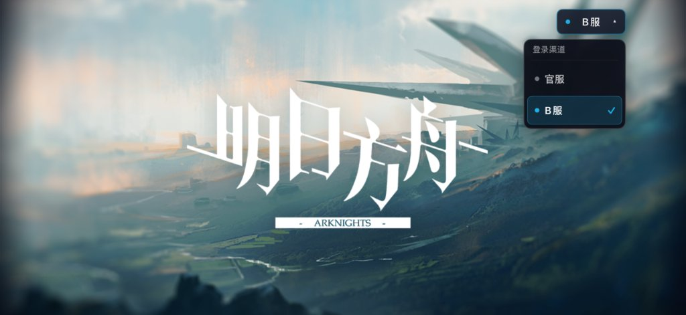
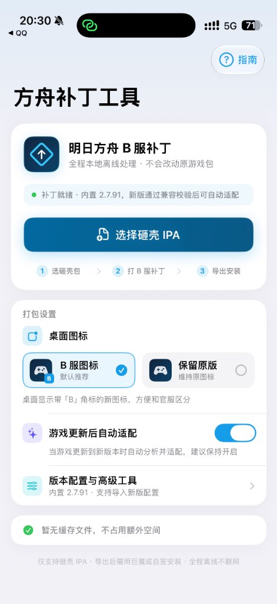

<div align="center">
  
  <h1>明日方舟 B 服 iOS 补丁工具</h1>
  <p><strong>BiliArknights IPA Patcher</strong></p>
  <p>在 iPhone / iPad 上直接给《明日方舟》官服<strong>砸壳 IPA</strong> 打上 B 服（哔哩哔哩）登录补丁，全程离线、十几秒生成待签名安装包。</p>

  <p>
    <a href="https://github.com/MiohalationM/BiliArknights-IPA-Patcher/releases/latest">
      
    </a>
    
    
    <a href="https://github.com/MiohalationM/BiliArknights-IPA-Patcher/actions/workflows/ci.yml">
      
    </a>
    <a href="LICENSE">
      
    </a>
  </p>

  <p>
    <a href="https://miohalationm.github.io/BiliArknights-IPA-Patcher/"><strong>项目主页</strong></a> ·
    <a href="https://github.com/MiohalationM/BiliArknights-IPA-Patcher/releases/latest"><strong>下载最新 IPA (v1.1.0)</strong></a> ·
    <a href="docs/PROFILE_FORMAT.md">手工配置规范</a> ·
    <a href="https://github.com/lazhire/Arknights-Bilibili-for-IOS">参考项目</a>
  </p>
</div>

---

## 实机效果预览

<div align="center">
  
  <br />
  <sub>游戏启动页实拍：右上角暗色悬浮切换按钮与下拉菜单，避让 12+ 适龄提示，进入服务器后自动隐藏</sub>
</div>

<br />

| App 首页与打包设置 | 打包完成与导出（2.79 GB / 16.3 秒） |
| :---: | :---: |
|  |  |

---

## 核心特性

- **广泛系统兼容**：支持 **iOS / iPadOS 16.0 及以上**，原生适配 iPhone 与 iPad 横竖屏，兼容 TrollStore（巨魔商店）及 AltStore / SideStore / Sideloadly 等主流自签工具。
- **本机离线打包**：本补丁工具本身全程离线、不上传文件，也不会改动原来的 IPA（修补后生成的游戏客户端在登录时仍需正常连接官方 / B 站服务器）。
- **流式高速出包**：仅重写发生变动的条目并做全包 CRC32 复核，iPhone 真机实测 2.79 GB 砸壳包「打包 + 完整性复核」总耗时约 **16.3 秒**（因机型与存储速度而异）。
- **融入游戏风格的切服交互**：右上角暗色按钮搭配自绘下拉菜单，支持启动页提前选服，弹出登录窗或进入主界面后自动收起，避免误触与视觉干扰。
- **长期版本适配**：
  - 内置 `2.7.91 (Build 76)` 已验证配置（底座 `r5`），开箱即用。
  - 游戏更新后可直接在 App 内导入新的手工 JSON 配置（规范见 [docs/PROFILE_FORMAT.md](docs/PROFILE_FORMAT.md)），无需重装工具。
  - 遇到未适配版本时，支持自动解析 IL2CPP 偏移并在通过字节级与段界兼容性校验后出包，同时可导出配置 JSON 分享给其他玩家。
- **可选 B 服图标与安全限制**：支持替换为带「B」角标的桌面图标以区分官服，也可保留原图标；修补后的游戏客户端内已统一禁用应用内充值入口。

---

## 四步快速上手

1. 前往 [Releases](https://github.com/MiohalationM/BiliArknights-IPA-Patcher/releases/latest) 下载最新的 `ArknightsPatcher-*-unsigned.ipa`。
2. 使用 **TrollStore（巨魔商店）** 或 **AltStore / SideStore / Sideloadly** 等工具安装到 iPhone / iPad。
3. 准备好已砸壳的《明日方舟》官服 IPA，在 App 首页点击 **「选择砸壳 IPA」**，十几秒后导出生成的 B 服 IPA 并同样安装到设备。
4. 打开游戏，在启动页点击右上角悬浮按钮切换到 **「B服」**，即可使用 B 站账号登录。

---

## v1.1.0 更新亮点

- **系统兼容下探至 iOS / iPadOS 16.0+**，补齐 iPad 横竖屏适配。
- **全新视觉与新手引导**：重绘全部界面与玩家友好的中文文案，新增 4 步使用指南、可视化 B 服图标二选一卡片及更高对比度按钮。
- **游戏内切服桥接全面升级（`7.5-2.7.91-bridge-carrier-r5`）**：按钮移至右上角并避让适龄提示，替换为暗色工业风自绘下拉菜单，支持启动阶段自动预选并在弹窗/进服/进入主界面后自动隐藏。
- **稳定性与校验加固**：新增手工/自动偏移 ARM64 对齐与 Mach-O 段界预检、无碰撞原子化配置存储、启动清理竞态修复、`Documents/Inbox` 缓存清理与统计、iOS 26 弹窗交互修复，并新增 Bridge 单测与 GitHub Actions CI。

---

## 源码构建与验证

> 开源仓库不包含闭源第三方 SDK 载体 `payload.zip` 和构建好的 `.ipa`（已加入 `.gitignore`），日常使用请直接下载 [Releases](https://github.com/MiohalationM/BiliArknights-IPA-Patcher/releases/latest) 里的未签名 IPA。桥接源码与底座打包流程详见 [Bridge/README.md](Bridge/README.md)。

```bash
# 运行核心库测试（Zip64Kit + IPAPatcherCore，无需闭源 payload.zip 即可全量通过）
swift test --package-path Packages/IPAPatcherCore

# 运行桥接层 C / Objective-C 单元测试
./Bridge/tests/run_tests.sh

# 生成 Xcode 工程（需安装 xcodegen）
xcodegen generate
```

---

## 参考项目

- B 服桥接与适配思路参考自：[lazhire/Arknights-Bilibili-for-IOS](https://github.com/lazhire/Arknights-Bilibili-for-IOS)

## 免责声明

- 本项目仅用于技术学习与研究（ZIP64 流式打包、Mach-O 注入与 IL2CPP 分析），不提供任何游戏本体或砸壳 IPA。
- 使用修改或重签名客户端可能违反游戏服务条款，相关账号风险与后果请自行承担。
- 本仓库自研源码基于 [MIT License](LICENSE) 开源；第三方游戏本体、闭源 SDK 载体及美术资源的权利归各自权利人所有，本项目不提供也不授权任何第三方内容的再分发、售卖或付费代打包。
