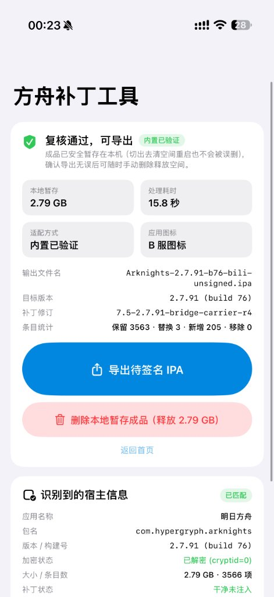

<div align="center">
  
  <h1>ArknightsPatcher（方舟补丁工具）</h1>
  <p><strong>明日方舟 B 服（哔哩哔哩）iOS 客户端离线补丁工具 · Arknights Bilibili iOS Offline IPA Patcher</strong></p>
  <p>
    关键词：<code>Arknights</code> · <code>Bilibili</code> · <code>iOS</code> · <code>明日方舟</code> · <code>B服</code> · <code>哔哩哔哩</code> · <code>IPA</code> · <code>IL2CPP</code>
  </p>
  <p>
    <a href="https://miohalationm.github.io/ArknightsPatcher/">项目主页 (GitHub Pages)</a> ·
    <a href="https://github.com/MiohalationM/ArknightsPatcher/releases">下载最新 IPA (Releases)</a> ·
    <a href="https://github.com/lazhire/Arknights-Bilibili-for-IOS">参考项目 (Arknights-Bilibili-for-IOS)</a>
  </p>
</div>

---

## 项目简介

**ArknightsPatcher（方舟补丁工具）** 是一款运行在 iPhone / iPad 上的原生 SwiftUI 离线工具，用于在本地为已解密的《明日方舟》（Arknights）iOS 客户端 IPA 包注入 B 服（哔哩哔哩 / Bilibili）登录桥接组件，生成可自签名安装的待签名 IPA。

- **全程离线、原包只读**：所有解析、修补与复核均在设备本地完成，不连接任何第三方服务器，绝不修改用户原始 IPA 文件。
- **极速流式 ZIP64 引擎**：针对 2.8 GB+ 大体积 IPA 优化，仅对修改/新增条目重新打包，未改动条目直接流式直通；iPhone 真机实测处理 2.79 GB IPA 仅需约 **15.8 秒**。
- **三层版本适配体系**：
  1. **内置已验证基准**：内置 `2.7.91 (build 76)` 完整偏移与补丁底座（206 项清单与 SHA-256 校验）。
  2. **外部手工适配配置**：支持从 App 内导入更新版本的 JSON 手工配置文件，游戏更新时无需重新编译安装 App。
  3. **IL2CPP 自动适配**：遇到未知新版本时，可自动解析单份 IPA 内的 `UnityFramework` 与 `global-metadata.dat`，结合结构体布局与特征校验定位偏移。
- **B 服桌面图标可选**：支持一键切换为带「B」角标的 B 服专属桌面图标，或保留官服原版图标，方便多开区分。
- **安全暂存与恢复**：采用原子写入与先落盘后清理策略，生成后的待签名 IPA 安全暂存本地，防止切后台或重启误丢。

---

## 应用界面截图

| 首页与修补选项 | 复核通过与导出（2.79 GB · 15.8 秒） |
| :---: | :---: |
|  |  |

---

## 完整性校验说明（Build 13 导出性能优化）

为了兼顾大体积 IPA 的导出速度与产物可靠性，当前版本在导出复核阶段采用以下校验策略：

1. **输入底座核验**：修补前核验内置 `manifest.json`、`payload.zip` 及全部 206 项补丁资源的 SHA-256。
2. **全量 ZIP 目录与 CRC32 校验**：产物写入 `.partial` 临时文件后，逐一核对全部条目的清单一致性，并流式解压校验全量条目的 **CRC32 与解压后字节长度**（实测 3566 项）。
3. **修改/新增条目 SHA-256 校验**：对所有被替换或新增的补丁条目逐项计算并比对 **SHA-256**，确保注入二进制与配置零损坏。
4. **跳过整包全量 SHA-256 二次通读**：不再于每次导出末尾重复通读整个 ~2.8 GB 输出 IPA 计算整包 `outputSHA256`，大幅缩短等待时间（真机实测耗时降至 **15.8 秒**）。

---

## 参考与致谢

- 核心 B 服桥接思路与早期适配方案参考自开源项目：[lazhire/Arknights-Bilibili-for-IOS](https://github.com/lazhire/Arknights-Bilibili-for-IOS)

---

## 目录结构

```text
ios-ipa-tool/
├── App/                        # SwiftUI iOS 主程序（视图、状态协调、本地暂存管理）
├── Bridge/                     # Objective-C/C 运行时桥接源码（ABRuntime / ABHook 等）
├── Packages/IPAPatcherCore/    # 核心修补引擎（Zip64Kit、Mach-O 解析、IL2CPP 自动定位、CLI）
├── Tests/                      # 核心单元测试与回归测试
├── docs/                       # GitHub Pages 静态主页与界面资源
└── project.yml                 # XcodeGen 工程配置
```

> **说明**：出于体积与版权合规考虑，内置二进制资源包 `payload.zip` 与构建产物 `*.ipa` 已通过 `.gitignore` 排除，不会提交至 Git 仓库；可直接前往 [Releases](https://github.com/MiohalationM/ArknightsPatcher/releases) 下载已打包的待签名 IPA，或自行构建后注入资源使用。

---

## 快速开始

### 方式一：直接下载 IPA 安装（推荐）
1. 前往 [Releases 页面](https://github.com/MiohalationM/ArknightsPatcher/releases) 下载最新 `ArknightsPatcher-*-unsigned.ipa`。
2. 使用 AltStore / SideStore / Sideloadly / 巨魔商店（TrollStore）等常用工具签名并安装到 iPhone / iPad。
3. 在 App 内选择已解密的《明日方舟》官服 IPA，等待复核通过后导出待签名 IPA 并安装即可。

### 方式二：本地源码构建
```bash
# 1. 运行核心单元测试
swift test --package-path Packages/IPAPatcherCore

# 2. 生成 Xcode 工程（需安装 xcodegen）
xcodegen generate

# 3. 使用 Xcode 打开 ArknightsPatcher.xcodeproj 构建运行
```

---

## 免责声明与开源协议

> [!WARNING]
> **重要免责声明（使用前请仔细阅读）**
>
> 1. **学习与技术研究用途**：本项目仅用于 iOS IPA 打包结构（ZIP64）、Mach-O 载入机制与 IL2CPP 元数据解析的技术学习与开源交流，**不提供、不分发任何游戏本体、已解密 IPA 文件或受版权保护的游戏资源**。
> 2. **账号与合规风险自负**：使用第三方修改或重签名客户端登录游戏可能违反游戏发行方或平台的服务条款（ToS），由此可能产生的一切账号封禁、数据异常或其他损失均由使用者自行承担，本项目作者与贡献者不承担任何直接或连带责任。
> 3. **严禁商业用途**：严禁将本项目或其衍生构建产物用于任何商业贩卖、付费代打包、捆绑推广或违法违规用途。
> 4. **开源协议**：本项目源代码基于 [MIT License](LICENSE) 开源；引用的第三方游戏资源、图标或桥接依赖的知识产权归其各自权利人所有。若任何权利人认为本仓库内容涉及侵权，请联系仓库维护者及时处理。
