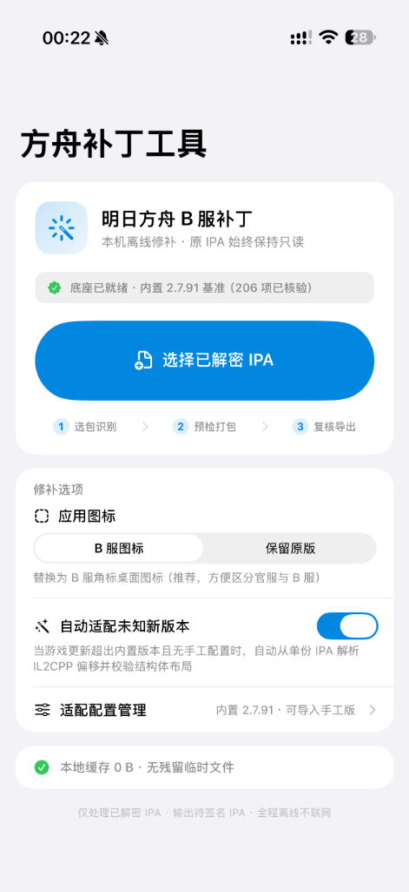

<div align="center">
  
  <h1>明日方舟 B 服 iOS 补丁工具</h1>
  <p><strong>BiliArknights IPA Patcher</strong></p>
  <p>在 iPhone / iPad 上直接给已解密的《明日方舟》官服 IPA 打上 B 服（哔哩哔哩）登录补丁，生成待签名 IPA。</p>
  <p>
    <a href="https://miohalationm.github.io/BiliArknights-IPA-Patcher/">项目主页</a> ·
    <a href="https://github.com/MiohalationM/BiliArknights-IPA-Patcher/releases">下载 IPA (Releases)</a> ·
    <a href="https://github.com/lazhire/Arknights-Bilibili-for-IOS">参考项目</a>
  </p>
</div>

---

## 功能

- **本地离线处理**：不联网，也不会修改原来的 IPA 文件。
- **速度较快**：只重打包改动过的文件，2.8 GB 左右的 IPA 在 iPhone 上大概十几秒处理完。
- **版本适配**：
  - 内置 `2.7.91 (build 76)` 已验证配置，开箱即用。
  - 游戏更新后可直接在 App 里导入新的手工 JSON 配置，不用重装 App。
  - 遇到未适配的新版本时，支持自动从 IPA 里解析 IL2CPP 偏移。
- **可选 B 服图标**：可以换成带「B」角标的桌面图标，方便和官服区分，也可以保留原版图标。

## 界面截图

| 首页与选项 | 打包完成与导出 |
| :---: | :---: |
|  |  |

## 使用方法

1. 去 [Releases](https://github.com/MiohalationM/BiliArknights-IPA-Patcher/releases) 下载最新的 `*-unsigned.ipa`。
2. 用 TrollStore（巨魔商店）、AltStore、SideStore 或 Sideloadly 等工具签名安装到设备。
3. 准备好已解密的《明日方舟》官服 IPA，在 App 里选择它，完成后导出生成的待签名 IPA 并安装。

## 参考项目

- B 服桥接与适配思路参考自：[lazhire/Arknights-Bilibili-for-IOS](https://github.com/lazhire/Arknights-Bilibili-for-IOS)

## 源码构建

> 仓库内不包含 `payload.zip` 和编译好的 `.ipa`（体积较大，已加入 `.gitignore`），日常使用直接下载 Releases 里的安装包即可。

```bash
# 运行核心库测试
swift test --package-path Packages/IPAPatcherCore

# 生成 Xcode 工程（需要 xcodegen）
xcodegen generate
```

## 免责声明

- 本项目仅用于技术学习与研究（ZIP64 打包、Mach-O 与 IL2CPP 分析），不提供任何游戏本体或已解密 IPA。
- 使用修改或重签名客户端可能违反游戏服务条款，相关账号风险与后果请自行承担。
- 严禁将本项目或生成产物用于任何商业售卖、付费代打包或违法用途。
- 本项目源码基于 [MIT License](LICENSE) 开源；涉及的第三方游戏名称、图标等权利归各自权利人所有。
